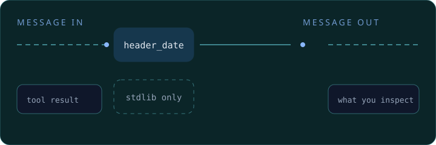

<p align="center">
  
</p>

<p align="center">
  <a href="https://pypi.org/project/header-date/"></a>
  <a href="https://pypi.org/project/header-date/"></a>
  <a href="https://pypi.org/project/header-date/"></a>
  <a href="https://github.com/sandeshbagmare/header-date/actions/workflows/ci.yml"></a>
  <a href="https://github.com/sandeshbagmare/header-date/blob/main/LICENSE"></a>
  <a href="https://sandeshbagmare.github.io/header-date/"></a>
  <a href="https://pypi.org/project/header-date/"></a>
</p>

<h3 align="center">HTTP dates parsed strictly, formatted correctly</h3>
<p align="center"><em>Standard library only. No runtime dependencies. Python 3.9+.</em></p>

<p align="center">
  
</p>

## Install

```console
pip install header-date
```

## Use

```python
from header_date import InvalidHTTPDate, format, now, parse, to_timestamp

parse("Sun, 06 Nov 1994 08:49:37 GMT")            # aware datetime in UTC
parse("Mon, 06 Nov 1994 08:49:37 GMT", strict=False)  # accept the wrong weekday
format(moment)                                     # 'Sun, 06 Nov 1994 08:49:37 GMT'
now()                                              # the current time, canonical form
to_timestamp("Thu, 01 Jan 1970 00:00:00 GMT")       # 0.0
```

## What is accepted

| form | example |
| ---- | ------- |
| IMF-fixdate (RFC 9110) | `Sun, 06 Nov 1994 08:49:37 GMT` |
| RFC 850 (obsolete) | `Sunday, 06-Nov-94 08:49:37 GMT` |
| asctime (obsolete) | `Sun Nov  6 08:49:37 1994` |

- zones `GMT`, `UTC` and numeric `+0000` are accepted; anything else is rejected
- month and weekday names are matched case-insensitively, and full weekday names work
- a two-digit year maps to the most recent past year with those digits (`94` → 1994,
  `25` → 2025), as RFC 9110 asks
- impossible dates (`31 Feb`, `25:00:00`) are rejected, not rolled over
- `format` always writes the canonical IMF-fixdate, converting other zones to UTC

## Limits

- Only seconds resolution: HTTP dates have no fractional seconds.
- Leap seconds (`:60`) are rejected.
- `format` does not support years before 1000 or after 9999.

## Development

```console
python -m venv .venv
.venv/bin/pip install -e ".[test]"
.venv/bin/pytest
```

The suite covers every line of the package (`pytest --cov --cov-branch`), and the
examples in the docstrings run as tests through `--doctest-modules`.

## License

MIT.
